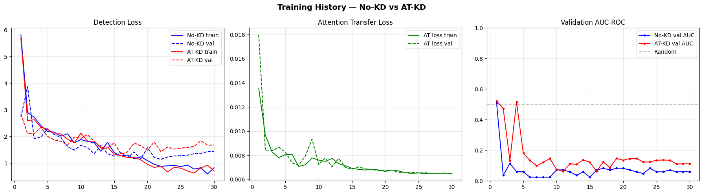
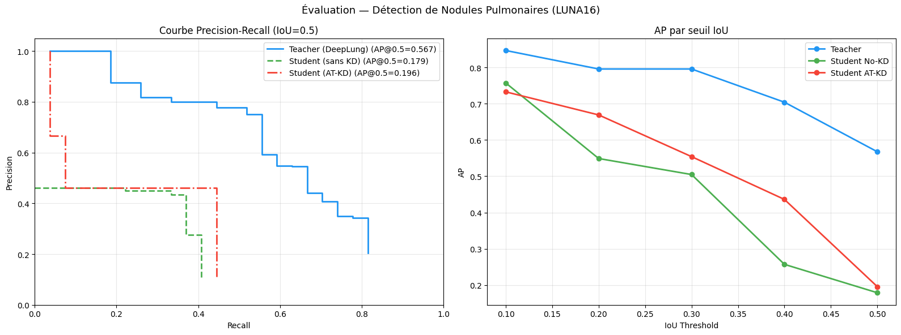
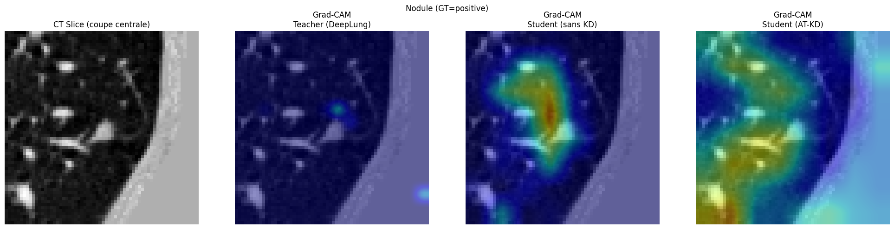
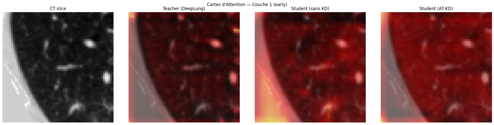
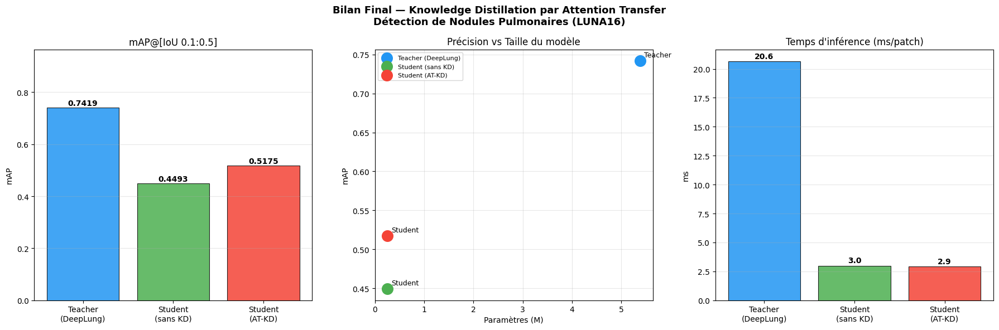

# Knowledge Distillation by Attention Transfer for 3D Lung Nodule Detection

Knowledge distillation for compact 3D pulmonary-nodule detection on LUNA16. A lightweight `TinyRes3D` student learns from a frozen DeepLung teacher by matching intermediate spatial attention maps in addition to the detection loss.

> Course project — 2IA, ENSIAS / Université Mohammed V, Rabat
> Authors: ACHAKOURI Mohamed and AQIL Ali

## Highlights

| Model | Parameters | mAP@[0.1:0.5] | Inference / patch |
| --- | ---: | ---: | ---: |
| Teacher — DeepLung | 5.38M | 0.7419 | 20.65 ms |
| Student — no KD | 0.25M | 0.4493 | 3.00 ms |
| Student — AT-KD | 0.25M | **0.5175** | **2.94 ms** |

Attention Transfer improves the compact student by **+6.82 percentage points mAP** over the non-distilled baseline, while retaining **69.8%** of the teacher mAP. The student is approximately **21.1× smaller** and **6.9× faster** than the teacher in the reported benchmark.

## Method

```text
LUNA16 CT scans
      │
      ▼
DeepLung preprocessing → 64³ voxel patches + nodule annotations
      │
      ├── Frozen DeepLung teacher
      │         │
      │         └── intermediate attention maps
      │
      └── TinyRes3D student ── detection loss + β · attention-transfer loss
```

The attention map of a 3D feature tensor is formed by summing squared activations across channels and applying L2 normalization. Four intermediate teacher/student feature pairs are aligned with adaptive pooling and channel adapters.

The total objective is:

```text
L_total = L_detection + β · L_attention
```

with `β = 50`, AdamW, batch size 8, cosine learning-rate decay, and 30 epochs per student-training phase.

## Dataset and preprocessing

The project uses LUNA16 candidate patches. The report experiment uses subset 0 because of storage constraints: 89 CT scans and 514 candidate patches, with patient-level train/validation/test splits. CT volumes are resampled to 1 mm isotropic spacing, intensity-normalized, lung-masked, and cropped before 64³ patches are sampled.

The notebook is configured for Kaggle paths and expects the LUNA16 data, the lung-segmentation masks, and the pre-trained DeepLung checkpoint to be available externally. These large assets are intentionally not included in this repository.

## Repository contents

- [`final-v-sujet-2-distill.ipynb`](final-v-sujet-2-distill.ipynb) — end-to-end Kaggle notebook covering preprocessing, models, training, evaluation, Grad-CAM, and benchmarking.
- [`Rapport_Sujet2_AT_Detection.pdf`](Rapport_Sujet2_AT_Detection.pdf) — project report.
- [`assets/`](assets/) — figures extracted from the report and shown below.

## Results

### Training dynamics



### Detection metrics



### 3D Grad-CAM comparison



### Attention-map alignment



### Efficiency summary



## Running the notebook

1. Open `final-v-sujet-2-distill.ipynb` in Kaggle with a GPU runtime.
2. Attach a LUNA16 dataset containing the CT subsets, annotations, candidates, and lung masks.
3. Update the dataset paths in the notebook if your Kaggle dataset layout differs.
4. Run the cells from top to bottom. The notebook clones the DeepLung implementation and expects its pre-trained checkpoint to be supplied at runtime.

The notebook installs the main runtime dependencies itself. For a local environment, the core packages are listed in [`requirements.txt`](requirements.txt), but the Kaggle-specific paths and data preparation still need to be adapted.

## Limitations

- Only a small LUNA16 subset was used because of disk constraints.
- The reported validation and test sets share the same 108 samples in the constrained experiment; results should therefore be treated as a course-project benchmark rather than a fully independent evaluation.
- The notebook is an experiment artifact rather than a packaged inference library. Paths, checkpoint loading, and dataset preparation need cleanup before production use.

## References

1. Zagoruyko and Komodakis, *Paying More Attention to Attention*, ICLR 2017.
2. Zhu et al., *DeepLung: Deep 3D Dual Path Nets*, WACV 2018.
3. Setio et al., *Validation of deep learning methods for the detection of pulmonary nodules in CT images*, Medical Image Analysis, 2017.
4. Hinton et al., *Distilling the Knowledge in a Neural Network*, NeurIPS 2015.
